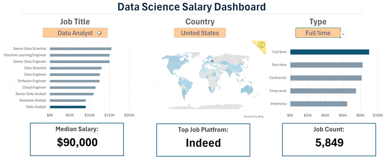
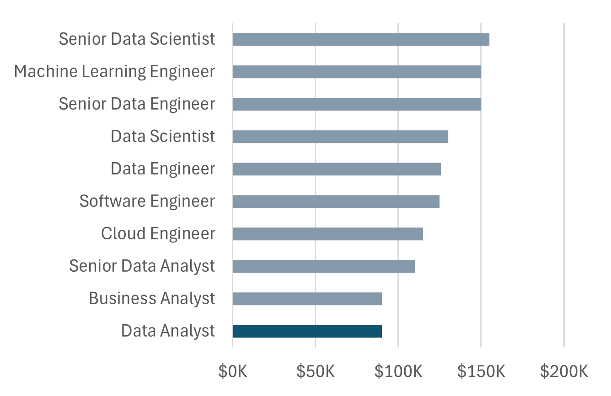
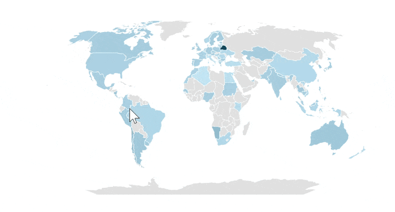
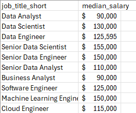
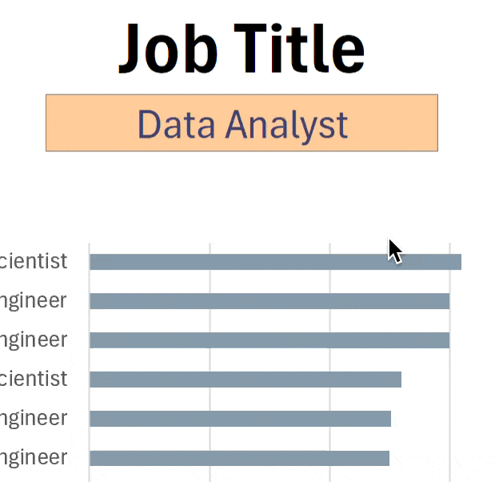

# Data Jobs Salary Explorer (Excel)





## Overview

An interactive Excel dashboard for comparing pay across data-related roles. Pick a job title, a country and an employment type, and the dashboard returns the median salary for that combination. It is meant to help job seekers check whether an offer is fair.

**Workbook:** [Salary_Dashboard.xlsx](Salary_Dashboard.xlsx)

## Excel Skills Used

- **📉 Charts:** built a bar chart and a map chart to compare pay across roles and countries
- **🧮 Formulas and Functions:** wrote array formulas with `MEDIAN`, `IF`, `FILTER`, `SEARCH` and `ISNUMBER` to pull salaries based on multiple conditions
- **❎ Data Validation:** created drop-down lists so users can only pick valid job titles, countries and schedule types

## Data

The data is a 2023 dataset of real data-job postings, provided through a guided Excel course. Each posting records:

- Job title
- Average yearly salary
- Country
- Schedule type (full-time, contract, etc.)
- Required skills

## Tools and Techniques

| Area | What I used |
|------|-------------|
| Visualization | Bar chart, map chart |
| Calculation | `MEDIAN`, `IF`, `FILTER`, `SEARCH`, `ISNUMBER` |
| Interactivity | Data validation drop-down lists |

## How It Works

### 1. Charts

**Median salary by job title (bar chart)**
- Shows the median salary for each role as horizontal bars.
- Roles are sorted from highest to lowest pay, so the ranking is easy to read.
- Takeaway: senior and engineering roles earn noticeably more than analyst roles.





**Median salary by country (map chart)**
- Plots each country that has salary data on a world map.
- Shading shows how pay levels differ between regions at a glance.





### 2. Formulas

**Median salary for a chosen role, country and type**

```
=MEDIAN(
  IF(
    (jobs[job_title_short]=A2) *
    (jobs[job_country]=country) *
    (ISNUMBER(SEARCH(type, jobs[job_schedule_type]))) *
    (jobs[salary_year_avg]<>0),
    jobs[salary_year_avg]
  )
)
```

This is an array formula. It keeps only the rows that match all the chosen filters and skips rows with no salary, then returns the median of what remains.

**Clean list of schedule types**

```
=FILTER(J2#, (NOT(ISNUMBER(SEARCH("and", J2#)) + ISNUMBER(SEARCH(",", J2#)))) * (J2#<>0))
```

Some postings list several schedule types in one cell. This formula drops those combined entries and the zeros, leaving a clean list of single types.





### 3. Data Validation

The cleaned lists feed drop-down menus for **Job Title**, **Country** and **Type**. This means:
- Users can only choose valid values.
- Typos and mismatched entries can't break the formulas.
- The dashboard is simpler to use.





## Conclusion

This project turned a raw jobs dataset into a tool for comparing salaries by role, location and employment type. It gave me practice with array formulas, dynamic lists and interactive controls in Excel.

## Credits

Built as a guided project from Luke Barousse's Excel course.

