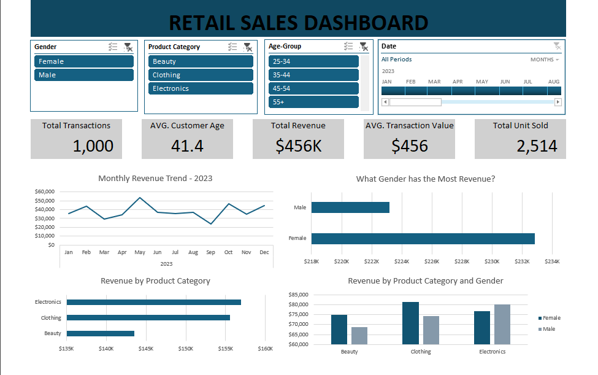
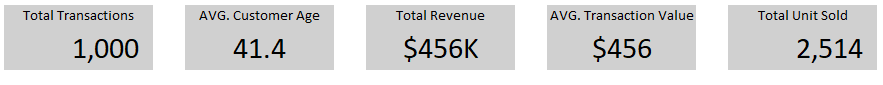

# 🛍️ Retail Sales Analysis Dashboard (Excel)

An interactive Excel dashboard that analyses 1,000 retail transactions from 2023 to show **how much is sold, what sells, and who is buying**. It is built with an Excel Table, calculated columns, PivotTables, PivotCharts, slicers and a timeline, and all of it is driven from one clean data sheet.


---
## 📑 Table of Contents

1. [Project Overview](#-project-overview)
2. [Business Questions](#-business-questions)
3. [Key Results](#-key-results-at-a-glance)
4. [Dataset](#-dataset)
5. [Data Preparation](#-data-preparation)
6. [Workbook Structure](#-workbook-structure)
7. [Dashboard Walkthrough](#-dashboard-walkthrough)
8. [Key Insights](#-key-insights)
9. [Recommendations](#-recommendations)
10. [How to Use the Dashboard](#-how-to-use-the-dashboard)
11. [Tools and Skills Demonstrated](#-tools-and-skills-demonstrated)
12. [Limitations](#-limitations)
13. [Repository Structure](#-repository-structure)
14. [Author](#-author)
---

## 🎯 Project Overview

Retail teams need a fast way to see what is driving revenue. This project turns a flat transaction log into a one-page dashboard that lets a viewer filter by **gender, product category, age group and date**, and watch every KPI and chart update at once.

**Objectives**
- Summarise overall sales performance with headline KPIs.
- Track revenue over time to spot seasonality.
- Compare product categories by revenue.
- Understand customer demographics (gender and age) and how they relate to spending.

## ❓ Business Questions

| # | Question | Where it is answered |
|---|----------|----------------------|
| 1 | How many transactions, how much revenue and how many units were sold overall? | KPI cards |
| 2 | How does revenue change month to month? | Monthly Revenue Trend line chart |
| 3 | Which product category earns the most? | Revenue by Product Category chart |
| 4 | Which gender generates the most revenue? | "What Gender has the Most Revenue?" chart |
| 5 | How does each category perform across genders? | Revenue by Product Category and Gender chart |
| 6 | Which age groups spend the most? | Revenue by age group pivot, and the Age-Group slicer |

## 📊 Key Results at a Glance

| KPI | Value |
|-----|-------|
| Total Transactions | **1,000** |
| Total Revenue | **456,000** |
| Average Transaction Value | **456.00** |
| Total Units Sold | **2,514** |
| Average Customer Age | **41.4 years** |




## 🗂️ Dataset

- **File / sheet:** `retail_sales_dataset` (raw data) → copied into `SalesData` (Excel Table `Table1`, where the calculated columns are added)
- **Size:** 1,000 rows × 9 original columns (12 columns after preparation)
- **Period covered:** 1 Jan 2023 – 1 Jan 2024
- **Source:** *add the source link here (e.g. Kaggle or the company that provided it)*
---
### Data dictionary

| Column | Type | Description |
|--------|------|-------------|
| `Transaction ID` | Integer | Unique ID for each sale (1–1000) |
| `Date` | Date | Date of the transaction |
| `Customer ID` | Text | Customer identifier (`CUST001` …) |
| `Gender` | Text | Male / Female |
| `Age` | Integer | Customer age (18–64) |
| `Product Category` | Text | Beauty, Clothing or Electronics |
| `Quantity` | Integer | Units purchased (1–4) |
| `Price per Unit` | Integer | Unit price (one of 25, 30, 50, 300 or 500) |
| `Total Amount` | Integer | Quantity × Price per Unit |
| `Month` | Text, *calculated* | Month name taken from `Date` |
| `Age-Group` | Text, *calculated* | Age band: 18-24, 25-34, 35-44, 45-54, 55+ |
| `Month Year` | Text, *calculated* | Month and year, e.g. "November 2023" |


## 🧹 Data Preparation

Quality checks run on the dataset:

- ✅ **No missing values** in any column
- ✅ **No duplicate** Transaction IDs
- ✅ `Total Amount` equals `Quantity × Price per Unit` on every row
- ✅ Ages sit in a realistic range (18–64)

Transformations applied in Excel:

1. Converted the raw range to an **Excel Table** (`Table1`) so formulas and PivotTables expand automatically.
2. Added a **`Month`** column with `=TEXT([@Date],"mmmm")`.
3. Added a **`Month Year`** column with `=TEXT([@Date],"mmmm yyyy")`.
4. Added an **`Age-Group`** column with `IFS` to bucket ages:

```excel
=IFS([@Age]<25,"18-24",
     [@Age]<35,"25-34",
     [@Age]<45,"35-44",
     [@Age]<55,"45-54",
     TRUE,"55+")
```

5. Built six PivotTables (one per chart or KPI block) and connected them to shared slicers.

---

## 🧱 Workbook Structure

The workbook has 9 sheets. Only the dashboard is visible. Everything else is hidden to keep the file clean.

| Sheet | Visible | Purpose |
|-------|---------|---------|
| `Dashboard` | ✅ | The final report: KPI cards, charts, slicers, timeline |
| `Month trend` | Hidden | PivotTable of revenue by month → feeds the line chart |
| `Product Performance` | Hidden | PivotTable of revenue by category → feeds the category chart |
| `rev by age` | Hidden | PivotTable of revenue by age group |
| `rev by gender` | Hidden | PivotTable of revenue by gender → feeds the gender chart |
| `catergory by gen and rev` | Hidden | PivotTable of category × gender revenue → feeds the clustered chart |
| `KPI pivot` | Hidden | PivotTable behind the KPI cards (read with `GETPIVOTDATA`) |
| `SalesData` | Hidden | Cleaned data table with calculated columns (the PivotTable source) |
| `retail_sales_dataset` | Hidden | Original raw data, kept untouched for reference |

> 💡 **To unhide a sheet:** right-click any sheet tab → **Unhide** → pick the sheet.

## 🖥️ Dashboard Walkthrough

### 1. KPI Cards
Five headline metrics sit across the top: **Total Transactions, Avg. Customer Age, Total Revenue, Avg. Transaction Value** and **Total Unit Sold**. Each is pulled from the `KPI pivot` with `GETPIVOTDATA`, so they respond to every slicer.

### 2. Slicers and Timeline
Slicers for **Gender**, **Product Category** and **Age-Group**, plus a **Date timeline**, sit along the top of the dashboard. See [How to Use](#-how-to-use-the-dashboard).


> 📸 **Image to add:** the slicer and timeline strip, ideally with one filter applied (e.g. Gender = Female) to show it working.

### 3. Monthly Revenue Trend – 2023 (line chart)
Shows total revenue for each month. Use it to spot seasonality and the strongest and weakest months.


> 📸 **Image to add:** the line chart on its own. **Caption:** *Revenue peaks in May and dips in September.*

### 4. Revenue by Product Category (bar chart)
Compares total revenue across Beauty, Clothing and Electronics.


> 📸 **Image to add:** the category bar chart. **Caption:** *Electronics and Clothing are almost level, with Beauty behind.*

### 5. Revenue by Product Category and Gender (clustered bar chart)
Splits each category's revenue between male and female customers.


> 📸 **Image to add:** the clustered bar chart. **Caption:** *Women lead in Beauty and Clothing, men lead in Electronics.*

### 6. What Gender Has the Most Revenue? (bar chart)
A direct comparison of total revenue by gender.


> 📸 **Image to add:** the gender chart. **Caption:** *Female customers contribute slightly more revenue overall.*

---

## 💡 Key Insights

*(Figures are for the full, unfiltered dataset.)*

### Overall performance
- The business recorded **1,000 transactions** worth **456,000** in revenue, an average of **456 per transaction**, across **2,514 units**.

### Time trend
| Month (2023) | Revenue |
|---|---|
| January | 35,450 |
| February | 44,060 |
| March | 28,990 |
| April | 33,870 |
| **May** | **53,150** (peak) |
| June | 36,715 |
| July | 35,465 |
| August | 36,960 |
| **September** | **23,620** (lowest) |
| October | 46,580 |
| November | 34,920 |
| December | 44,690 |

- **May is the strongest month** (53,150), and **September is the weakest** (23,620), a gap of more than 2×.
- Revenue rebounds sharply in **October (46,580)** and **December (44,690)**, which points to a late-year push, probably holiday-driven.

### Product categories
| Category | Revenue | Share | Transactions |
|---|---|---|---|
| Electronics | 156,905 | 34.4% | 342 |
| Clothing | 155,580 | 34.1% | 351 |
| Beauty | 143,515 | 31.5% | 307 |

- **Electronics narrowly leads** and beats Clothing by only 1,325 (0.3 percentage points). Revenue is spread fairly evenly across all three categories.
- Clothing has the **most transactions** (351), but Electronics earns slightly more from fewer of them.

### Customers
| Gender | Revenue | Share | Transactions |
|---|---|---|---|
| Female | 232,840 | 51.1% | 510 |
| Male | 223,160 | 48.9% | 490 |

- Women contribute **~51%** of revenue, a small but consistent lead.
- By category: **women lead in Beauty (74,830 vs 68,685) and Clothing (81,275 vs 74,305)**, while **men lead in Electronics (80,170 vs 76,735)**.

| Age group | Revenue | Transactions |
|---|---|---|
| 45-54 | 97,235 | 225 |
| 25-34 | 97,090 | 203 |
| 35-44 | 96,835 | 207 |
| 55+ | 90,190 | 216 |
| 18-24 | 74,650 | 149 |

- Four of the five age groups produce similar revenue (roughly 90k–97k). The **18-24 group is clearly the smallest** (74,650) with the fewest transactions (149).


## ✅ Recommendations

1. **Plan around seasonality.** Run promotions in the weak months (especially September) and make sure stock and staffing are ready for peaks in May, October and December.
2. **Target by category and gender.** Aim Beauty and Clothing campaigns at women, and Electronics campaigns at men.
3. **Grow the 18-24 segment.** It is the smallest group. Student offers, social media campaigns or loyalty schemes could help.
4. **Defend the middle.** Ages 25-54 deliver most of the revenue, so keep their loyalty and retention strong.
5. **Test bundles.** The three categories are almost equal in revenue, so cross-category bundles (e.g. Beauty + Clothing) could lift average basket value.


## 🕹️ How to Use the Dashboard

1. Open `dashboard/retail_sales_analysis.xlsx` in **desktop Excel** (Excel 2016 or later; the `IFS` function and slicers need a recent version).
2. Go to the **Dashboard** sheet.
3. Click the **slicer buttons** (Gender, Product Category, Age-Group) to filter. Hold **Ctrl** to select several, and click the funnel icon with the red ✕ to clear a filter.
4. Drag the **Date timeline** handles to focus on a period, or switch between Months, Quarters and Years.
5. Watch the KPI cards and charts update.
6. To refresh after changing the data: **Data → Refresh All**.

> ⚠️ Slicers and timelines work best in **desktop Excel**. They may not display or behave correctly in Google Sheets or LibreOffice.


## 🧰 Tools and Skills Demonstrated

- **Microsoft Excel:** Tables, PivotTables, PivotCharts, slicers, timelines
- **Formulas:** `IFS`, `TEXT`, `GETPIVOTDATA`
- **Data cleaning and validation:** checks for missing values, duplicates and calculation errors
- **Feature engineering:** deriving age groups and month fields
- **Dashboard design:** KPI cards, interactive filtering, clean layout
- **Business analysis:** turning numbers into insights and recommendations


## ⚠️ Limitations

- The data covers **one year** and a single dataset. It cannot show year-over-year growth.
- It has only **three broad product categories** and no cost or profit data, so the analysis measures **revenue, not profitability**.
- **Every transaction has a unique Customer ID**, so repeat-purchase and customer-lifetime-value analysis is not possible.
- The data includes a single transaction dated **1 Jan 2024** (1,530 revenue). Because the chart is titled "2023", this one-day point is a small extra and not a full month.
- Unit prices take only five values (25, 30, 50, 300, 500), which suggests the data may be synthetic or simplified.

## 👤 Author

**Emmanuel Muoghalu**, Data Analyst

⭐ If you found this project useful, feel free to star the repo!

